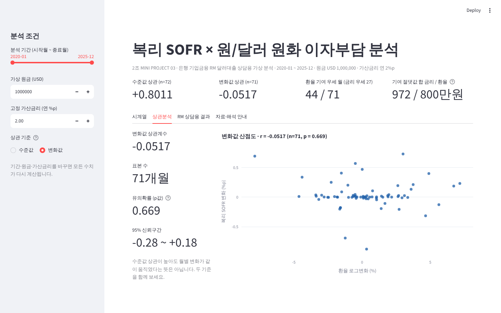
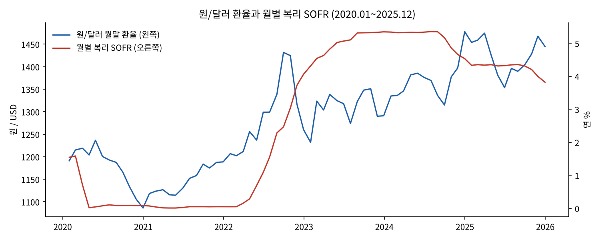
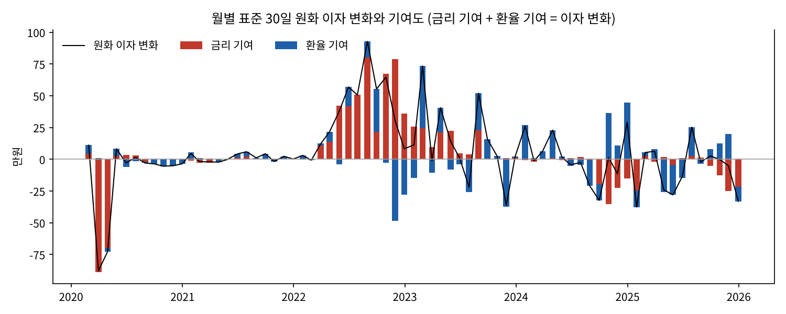
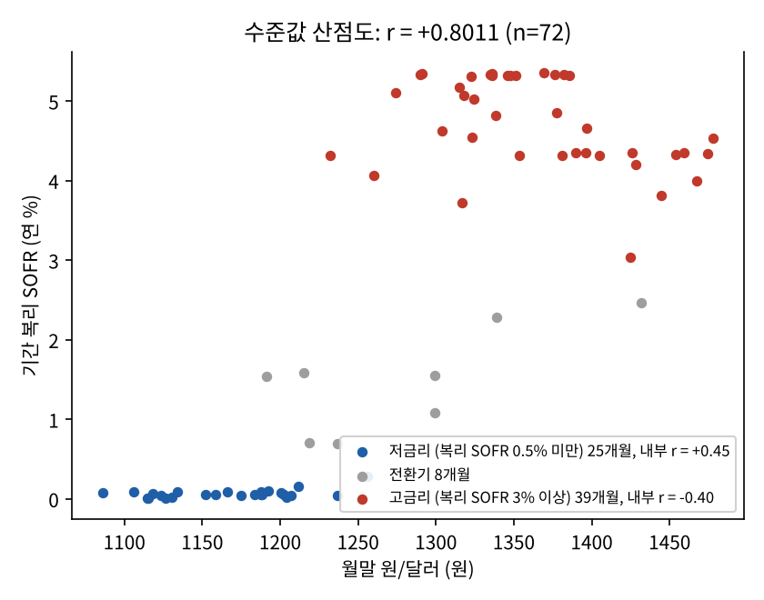
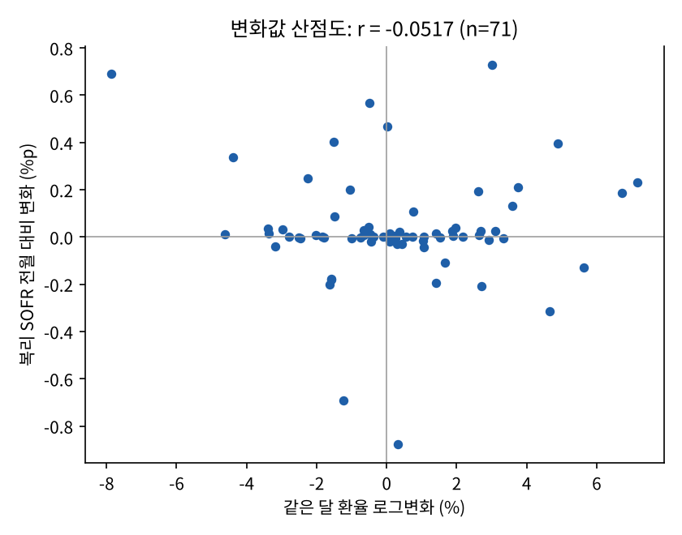

# 달러대출 이자가 늘었을 때, 금리 탓일까 환율 탓일까 — 원인 분해와 헤지 시나리오

> 달러 변동금리 대출의 원화 이자가 6년간 **352만원 → 700만원**으로 늘었습니다. 늘어난 348만원을 금리 몫(72%)과 환율 몫(28%)으로 나누고,
> **금리를 고정(IRS)했다면 274만원, 환율을 고정(선물환)했다면 123만원**을 줄일 수 있었는지 계산해 대비책에 숫자 근거를 붙였습니다.

| 항목 | 내용 |
|---|---|
| 형태 | KB Bridge 부트캠프 Module 04 미니프로젝트 03 · 5인 팀 (2조) |
| 사용 기술 | Python (Pandas, statsmodels, Matplotlib) · Streamlit · SQL (SQLite) · FRED 데이터 · Google Colab |
| 데이터 | 복리 SOFR·원/달러 환율 일별 1,493일 → 월별 72개월 (2020.01 – 2025.12) + 통제변수 3종 |
| 핵심 결과 | 이자 증가분의 72%가 금리 기여 · 월별 금리-환율 변화 상관 −0.05 (사실상 무관) · 헤지 수단별 절감액 비교 |

**내 역할** : 헤지 시나리오 분석 — 금리 고정(IRS), 환율 고정(선물환), 둘 다 고정한 경우를 비교해 늘어난 원화 이자 348만원 중 각 방법으로 줄일 수 있는 금액을 계산하고, 발표자료의 대비책 제안에 숫자 근거를 더함 (발표자료 부록 슬라이드)



---

## 01. 프로젝트 배경

2023년 6월 리보금리가 끝나면서 달러 대출의 기준금리는 **SOFR**(미국 담보부 익일물 금리)로 바뀌었습니다. 달러로 빌리고 원화로 갚는 기업은 **금리 위험과 환율 위험을 동시에** 집니다.
고객이 "이번 달 이자가 왜 늘었냐"고 물으면, 은행 기업금융 담당자(RM)는 금리 때문인지 환율 때문인지 숫자로 나눠 답할 수 있어야 합니다.

## 02. 업무 문제

1. 금리(SOFR)와 원/달러 환율은 같이 움직이나? (함께 움직인다면 한쪽만 보고 다른 위험을 판단해도 될까?)
2. 가상 차주의 원화 이자 변화 중 금리 몫과 환율 몫은 각각 얼마인가?
3. **각 위험을 막는 수단(IRS·선물환)은 늘어난 이자를 얼마나 줄일 수 있었나?** ← 내 담당

가상 차주: 원금 USD 1,000,000 · 고정 가산금리 연 2%p · 헤지 없음

## 03. 데이터 설명

| 자료 | 출처 | 주기 | 용도 |
|---|---|---|---|
| SOFR Index | 뉴욕 연준 → FRED | 일별 | 두 월말 사이 지수 비율로 기간 복리 SOFR 계산 |
| 원/달러 (DEXKOUS) | 미 연준 → FRED | 일별 | 월말 원화 환산, 환율 변화율 |
| 광의 달러지수 · VIX · 한국 3개월 금리 | FRED | 일별·월별 | 강건성 점검용 통제변수 |

- 공통 유효일 1,493일 → 월말 끝점 73개 → 이자 계산 기간 72개 → 월간 변화 71개
- 원본 파일의 sha256 해시를 `output/metrics.json`에 기록했습니다.

## 04. 데이터 전처리

| 처리 | 내용 |
|---|---|
| 공통 날짜만 사용 | 두 자료 모두 값이 있는 날만 결합, 휴일 결측을 직전 값으로 채우지 않음 |
| 월말 기준점 | 매달 마지막 공통 관측일을 끝점으로 사용 |
| 기간 복리 SOFR | (SOFR Index 말 ÷ 초 − 1) × 360 ÷ 실제 경과일수 |
| 숫자 기준 통일 | 조원마다 보던 파일 버전이 달라, `metrics.json` 하나를 기준으로 원본에서 재계산해 지표 10개 일치 확인 |
| 기간 자르기 오류 수정 | 앱에서 기간을 먼저 자르고 변화를 계산하면 첫 달이 빠짐 → 전체 계산 후 자르도록 수정 |

## 05. SQL 분석

월별 분석 테이블을 SQLite에 적재해 연도별 기여도를 확인했습니다. → [`sql/contribution_check.sql`](sql/contribution_check.sql)

```sql
SELECT SUBSTR(month, 1, 4)                 AS 연도,
       ROUND(SUM(d_cost) / 10000, 0)       AS 이자변화,
       ROUND(SUM(contrib_rate) / 10000, 0) AS 금리기여,
       ROUND(SUM(contrib_fx) / 10000, 0)   AS 환율기여
FROM monthly WHERE d_cost IS NOT NULL
GROUP BY 연도 ORDER BY 연도;
```

| 연도 | 이자 변화 | 금리 기여 | 환율 기여 |
|---|---:|---:|---:|
| 2020 | −163만원 | −148만원 | −15만원 |
| 2022 | **+434만원** | **+442만원** | −9만원 |
| 2024 | +14만원 | −92만원 | **+107만원** |
| 6년 합계 | +348만원 | +251만원 (72.1%) | +97만원 (27.9%) |

2022년 금리 인상기에는 금리가, 2024년에는 환율이 이자를 끌어올렸습니다. **해마다 주된 원인이 바뀝니다.**

## 06. Python 분석

**① 원인 분해** — 매달의 이자 변화를 금리 기여와 환율 기여로 나눕니다(교차항을 절반씩 나누는 대칭분해, 71개월 모두 오차 0.000000002원 이하).

**② 헤지 시나리오 (내 담당)** — 2020년 1월 수준으로 위험을 고정했다면 2025년 12월 이자가 얼마였을지 비교했습니다. → [`source/hedge_scenario.py`](source/hedge_scenario.py)

```python
def cost_30d(rate, fx):
    """표준 30일 원화 이자 = 원금 × (복리 SOFR + 가산금리) ÷ 12 × 월말 환율"""
    return PRINCIPAL * (rate + SPREAD) / 12 * fx

scenarios = {
    "헤지 없음":          cost_30d(r1, f1),   # 금리·환율 모두 2025-12 값
    "IRS (금리 고정)":    cost_30d(r0, f1),   # 금리만 2020-01 값으로 고정
    "선물환 (환율 고정)": cost_30d(r1, f0),   # 환율만 2020-01 값으로 고정
    "IRS + 선물환":       cost_30d(r0, f0),   # 둘 다 고정
}
```

| 시나리오 | 2025-12 월 이자 | 늘어난 이자 | 줄인 금액 | 줄인 비율 |
|---|---:|---:|---:|---:|
| 헤지 없음 | 700만원 | 348만원 | — | — |
| **IRS (금리 고정)** | 427만원 | 75만원 | **274만원** | **78.5%** |
| 선물환 (환율 고정) | 578만원 | 226만원 | 123만원 | 35.2% |
| IRS + 선물환 | 352만원 | 0원 | 348만원 | 100% |

- IRS 하나로 늘어난 이자의 약 79%를 막을 수 있었습니다. 이 차주에게 **먼저 점검할 대비책은 금리 고정**이라는 근거입니다.
- IRS(274만원)와 선물환(123만원)의 절감액을 더하면 348만원보다 큽니다. 금리와 환율이 **함께 올라 생긴 겹치는 부분**(약 49만원)이 두 계산에 모두 들어가기 때문입니다. 그래서 둘 다 고정했을 때의 효과는 단순 합계가 아니라 348만원입니다.

**③ 강건성 점검** — 상관 결과가 다른 방법에서도 버티는지 p값·신뢰구간·다중비교 보정(검정 31개)·회귀(HAC 표준오차)로 확인했습니다. 상세 표는 [`docs/제출용_상세README.md`](docs/제출용_상세README.md) 5-2절에 있습니다.

## 07. 시각화

| 복리 SOFR와 원/달러 시계열 | 월별 이자 변화의 금리·환율 기여 |
|---|---|
|  |  |

| 수준값 산점도 (상관 +0.80) | 변화값 산점도 (상관 −0.05) |
|---|---|
|  |  |

**Streamlit 앱** — 기간·원금·가산금리를 바꾸면 전체를 다시 계산하고, 시계열·상관분석·RM 상담용 결과 탭을 제공합니다. Windows는 `run_app.bat` 더블클릭으로 실행됩니다.

## 08. 주요 인사이트

1. **수준값 상관 +0.80은 착시였다.** 저금리 시대와 고금리 시대가 떨어져 있어서 생긴 숫자로, 금리 국면을 고정하면 금리 계수가 의미 없어졌습니다(p = 0.54).
2. **매달의 변화로 보면 금리와 환율은 따로 움직였다.** 변화값 상관 −0.05(p = 0.67). 한 변수로 다른 위험을 대신 판단할 수 없습니다.
3. **늘어난 이자 348만원 중 72%가 금리 몫이었다.** 다만 연도마다 주된 원인이 바뀌었습니다(2022년 금리, 2024년 환율).
4. **대비책도 원인 크기에 맞춰야 한다.** 이 차주는 IRS 하나로 증가분의 79%를 막을 수 있었고, 선물환은 35%였습니다. 원인을 나눠야 어떤 수단을 먼저 쓸지 정할 수 있습니다.

## 09. 생산·제조 업무 활용 방안

| 이 프로젝트 | 생산·제조 현장 적용 |
|---|---|
| 이자 변화 = 금리 기여 + 환율 기여 | **원가 변동 분해**: 제조원가 상승을 원자재 단가·환율·사용량·불량 손실 기여로 나눠 원인별로 대응 |
| 헤지 수단별 절감액 비교 | **개선안 효과 비교**: 설비 교체·공정 조건 변경·예방보전 등 대안별로 줄일 수 있는 손실을 같은 기준으로 계산해 우선순위 결정 |
| 단독 효과 합 ≠ 동시 적용 효과 | 개선안 두 개의 효과를 단순 합산하면 과대평가됨 → 겹치는 효과를 따로 확인 |
| 해마다 주된 원인이 바뀜 | 한 번 정한 관리 항목을 고정하지 않고 주기적으로 파레토를 다시 그림 |
| 수준값 상관 +0.80 착시 | 같은 기간에 둘 다 늘었다고 원인-결과로 보지 않음 (예: 생산량과 불량 수가 함께 늘어난 경우) |
| 조원별 숫자 불일치 → 기준 파일 통일 | 부서마다 다른 집계 기준을 하나의 기준 데이터로 맞추는 작업 |

## 10. 한계 및 개선 방향

- **헤지 비용을 넣지 않았습니다.** 실제 IRS는 계약 시점의 스왑 금리로, 선물환은 선물환 포인트가 붙은 환율로 고정되며 수수료도 듭니다. 이 분석은 "시작 시점 값으로 고정했다면"이라는 단순화 비교입니다.
- 2020-01 한 시점 대비 2025-12 한 시점을 비교했습니다. 시작 시점을 바꾸면 절감액이 달라지며, 기간 중 매달의 누적 이자 차이는 계산하지 않았습니다.
- 표준 30일 이자는 비교용 지표로, 실제 계약의 금리 재설정일·원금 상환을 반영하지 않습니다.
- 가상 대출 분석이며 실제 청구액·손익·신용위험이 아닙니다. 상관관계는 인과관계가 아니고, 투자·상품 권유가 아닙니다.

---

### 실행 방법

```bash
pip install -r requirements.txt
streamlit run app/app.py           # Windows는 run_app.bat 더블클릭
python source/hedge_scenario.py    # 헤지 시나리오 표 출력 + output/hedge_scenario.csv 저장
python sql/run_sql.py              # SQL 확인
```

맥·윈도우별 자세한 실행 안내, 열 설명, 강건성 점검 전체 표, 변경 기록은 [`docs/제출용_상세README.md`](docs/제출용_상세README.md), 데이터·함수 명세는 [`docs/API_명세서_v1.md`](docs/API_명세서_v1.md)에 있습니다.

### 폴더 구조

```
08_SOFR환율_이자부담_헤지분석/
├─ README.md
├─ source/        # 데이터 파이프라인·강건성 점검 노트북, 계산 모듈, 그래프, 헤지 시나리오
├─ app/           # Streamlit 분석 화면
├─ data/          # raw(FRED 원본 5종), processed(월별 분석 테이블)
├─ sql/           # SQL 확인 쿼리 + 실행 스크립트
├─ output/        # 그래프, 지표 JSON, 앱 화면, 헤지 시나리오 결과
├─ report/        # 분석결과 요약보고서 PDF
├─ presentation/  # 발표자료 PPT(24장 부록: 헤지 시나리오 분석), 발표대본 PDF
└─ docs/          # 제출용 상세 README, API 명세서
```
